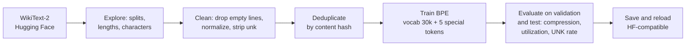

# A BPE Tokenizer from Scratch on WikiText-2

**Byte-level byte-pair encoding written out in plain Python (about 150 lines, no dependencies), trained on WikiText-2 and checked against Hugging Face's Rust implementation: same compression on held-out text, 99.9% of token boundaries in the same place.**

[](https://github.com/dojedaro/bpe-tokenizer-from-scratch/actions/workflows/notebooks.yml)
[](https://colab.research.google.com/github/dojedaro/bpe-tokenizer-from-scratch/blob/main/bpe_tokenizer_wikitext2.ipynb)

The repository has two parts:

1. **[`src/bpe/tokenizer.py`](src/bpe/tokenizer.py), the implementation.** Training, encoding, decoding
   and saving, with tests.
2. **[The notebook](bpe_tokenizer_wikitext2.ipynb), the data pipeline.** Exploring, cleaning and
   deduplicating WikiText-2, then training a 30k tokenizer with the Hugging Face `tokenizers` library
   and saving it in a format `transformers` loads. The notebook uses the library's trainer, not the code
   in `src/`.

## The implementation

```python
from bpe import BPETokenizer

tok = BPETokenizer.train(texts, vocab_size=8192)
ids = tok.encode("Tokenizers are the first layer of a language model.")
assert tok.decode(ids) == "Tokenizers are the first layer of a language model."
tok.save("bpe.json")
```

- **Byte-level.** The vocabulary starts as the 256 bytes, so any string encodes and there is no unknown
  token.
- **Merges stay inside chunks.** Text is split into words (with their leading space), digit runs,
  punctuation runs and whitespace, as GPT-2 does, so the tokenizer learns `" the"` once instead of
  `"the."` and `"the,"` separately.
- **Incremental training.** Training counts each unique chunk once, weighted by frequency. It keeps an
  index from every pair to the chunks containing it, and a heap of pair counts, so each merge only
  revisits the chunks it changes. A test checks that this produces exactly the same merges as the
  slow version that recounts every pair after every merge.
- **Deterministic.** Ties between equally frequent pairs go to the smallest pair.

### Checked against Hugging Face

[`scripts/compare_hf.py`](scripts/compare_hf.py) trains this tokenizer and Hugging Face's byte-level
BPE on the same cleaned training split (raw WikiText-2: 21,713 documents after dropping empty lines and
duplicates), then encodes the validation and test splits (5,153 documents, 2.4M characters):

| Vocabulary | Characters per token (this / HF) | Token boundaries in the same place | Training time (this / HF) | Exact round trip |
|---|---|---|---|---|
| 8,192 | 3.979 / 3.979 | 99.8% | 7.5 s / 2.6 s | yes |
| 30,000 | 4.649 / 4.649 | 99.9% | 6.1 s / 1.6 s | yes |

The two pre-tokenize with slightly different regexes (a stdlib `re` pattern here, GPT-2's pattern in
Hugging Face), which accounts for the boundaries that differ. Times are from one run on a laptop CPU;
the Rust library is about 3-4x faster to train. Saved outputs are in [`results/`](results/).

```bash
pip install -e ".[dev]"
pytest                                   # 8 tests, no downloads

pip install -e ".[compare]"
python scripts/compare_hf.py --vocab 8192
```

## The notebook: cleaning WikiText-2 and a 30k tokenizer


**Data cleaning** (WikiText-2, training split):

| Step | Examples | Notes |
|---|---|---|
| Raw | 36,718 | |
| Empty lines removed | 23,767 | 12,951 empty (35%) |
| Normalized | 23,732 | 54,625 `<unk>` markers removed; 3.7% fewer characters |
| Deduplicated (hash-based) | **21,329** | 2,403 duplicates removed (10.1%) |

**Tokenizer** (BPE, 30,000-token vocabulary, special tokens `[PAD] [UNK] [CLS] [SEP] [MASK]`):

| Metric | Value |
|---|---|
| Compression | **4.99 characters per token** (about 21 tokens per sentence) |
| Vocabulary utilization (share of the 30k tokens seen in evaluation) | 42.2% |
| Unknown-token rate | 0.000% |
| Reload check | Loads with both `tokenizers.Tokenizer.from_file` and `transformers.PreTrainedTokenizerFast` |

The 0% unknown rate needs one caveat: cleaning removed WikiText's own `<unk>` markers first, so the
tokenizer never has to represent them. Low vocabulary utilization (42%) is
expected when a 30k vocabulary is trained on a corpus this small; WikiText-2 is about 2M words.

### Pipeline



### Run the notebook

```bash
pip install -r requirements.txt
jupyter notebook bpe_tokenizer_wikitext2.ipynb
```

No GPU needed; the dataset downloads from the Hugging Face Hub. The notebook loads the version of
WikiText-2 that marks rare words as `<unk>` and uses a whitespace pre-tokenizer, so its numbers (for
example 4.99 characters per token) are not comparable with the byte-level table above.

## Stack

The implementation: Python standard library only. The notebook: Hugging Face `datasets`, `tokenizers`
(BPE trainer, whitespace pre-tokenizer), `transformers`, pandas, Matplotlib.

## Limitations and next steps

- This covers the data and tokenizer stage only; no model is trained here yet. The next step is a
  small GPT-style model on the cleaned corpus, reporting validation perplexity.
- Encoding is pure Python and replays merges per chunk (with a cache), which is fine for a corpus this
  size but much slower than the Rust library on large ones.
- No special tokens yet (`[PAD]`, `[CLS]` and so on); the notebook's Hugging Face tokenizer has them.

*The notebook was moved into its own repository on 2026-11-13 and renamed to describe what it builds. The from-scratch implementation in `src/` was added on 2026-11-16.*

## License

MIT
