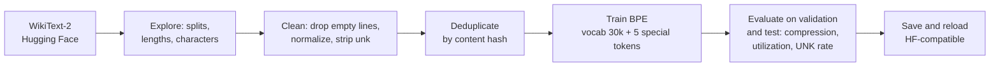

# A BPE Tokenizer from Scratch on WikiText-2

**The first stage of training a language model: cleaning a corpus, deduplicating it, training a 30,000-token byte-pair-encoding tokenizer, measuring it, and saving it so Hugging Face Transformers can load it.**

[](https://colab.research.google.com/github/dojedaro/bpe-tokenizer-from-scratch/blob/main/bpe_tokenizer_wikitext2.ipynb)
[](https://github.com/dojedaro/bpe-tokenizer-from-scratch/actions/workflows/notebooks.yml)

## Results

**Data cleaning** (WikiText-2, training split):

| Step | Examples | Notes |
|---|---|---|
| Raw | 36,718 | |
| Empty lines removed | 23,767 | 12,951 empty (35%) |
| Normalized | 23,732 | 54,625 `<unk>` markers removed; 3.7% fewer characters |
| Deduplicated (hash-based) | **21,329** | 2,403 duplicates removed (10.1%) |

**Tokenizer** (BPE, 30,000-token vocabulary, special tokens `[PAD] [UNK] [CLS] [SEP] [MASK]`):

| Metric | Value |
|---|---|
| Compression | **4.99 characters per token** (about 21 tokens per sentence) |
| Vocabulary utilization (share of the 30k tokens seen in evaluation) | 42.2% |
| Unknown-token rate | 0.000% |
| Reload check | Loads with both `tokenizers.Tokenizer.from_file` and `transformers.PreTrainedTokenizerFast` |

The 0% unknown rate needs one caveat: cleaning removed WikiText's own `<unk>` markers first, so the
tokenizer never has to represent them. Low vocabulary utilization (42%) is
expected when a 30k vocabulary is trained on a corpus this small; WikiText-2 is about 2M words.

## How it works



## Run it

```bash
pip install -r requirements.txt
jupyter notebook bpe_tokenizer_wikitext2.ipynb
```

No GPU needed; the dataset downloads from the Hugging Face Hub.

## Stack

Python, Hugging Face `datasets`, `tokenizers` (BPE trainer, whitespace pre-tokenizer), `transformers`,
pandas, Matplotlib.

## Limitations and next steps

- This covers the data and tokenizer stage only; no model is trained here yet. The next step is a
  small GPT-style model on the cleaned corpus, reporting validation perplexity.
- Compare against a byte-level BPE (as in GPT-2), which removes unknown tokens by construction instead
  of by cleaning.
- Sweep vocabulary size (8k, 16k, 30k) and report the compression vs. vocabulary-use trade-off.

*Extracted on 2026-11-13 from a catch-all coursework repository (where it was titled "Training LLM
from Scratch") into its own project, renamed to describe what it builds.*

## License

MIT
